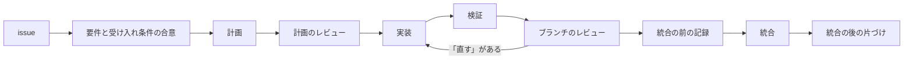

# 開発ワークフロー

Linear の issue を起点に、Claude Code が 1 つの作業を「要件の合意 → 計画 → 実装 → 検証 → レビュー → 統合 → 片づけ」まで進める流れの案内。レビューは Codex が受け持つ。

- 正本は `config/agents/AGENTS.md`（全プロジェクト共通の指示）、`config/agents/skills/` の skill（`issue`・`wrap-up`・`handoff`）、`bin/integrate`・`bin/codex-review`。この文書はその案内で、食い違えば正本が正しい
- 前半の「簡易版」だけで全体の流れと人の役目が分かる。後半の「詳細」はフェーズごとの決まりと、止まるとき

## 簡易版

### 流れ

| # | フェーズ | すること | 担当 | モデル | 人がすること |
| -- | -- | -- | -- | -- | -- |
| 0 | 準備（リポジトリごとに一度） | `integrate setup` で種類・最上位のブランチ・テストのコマンドを決める | メイン | Opus 5.5 high | 推測された設定を確かめる |
| 1 | issue の作成と着手 | issue を作る。`/issue ARK-nn` で始め、In Progress にする | メイン | Opus 5.5 high | 作業を頼む |
| 2 | 要件と受け入れ条件の合意 | 不明点を質問し、要件と受け入れ条件を issue の本文に書く | メイン | Opus 5.5 high | 質問に答え、合意する |
| 3 | ブランチと worktree | `feature/<作業内容>` を `.worktrees/` の下に作る | メイン | Opus 5.5 high | — |
| 4 | 計画 | 計画書を書く | サブエージェント（plan） | opus・xhigh | — |
| 5 | 計画のレビュー | `codex-review plan` を 1 回。「直す」を計画書に反映する | Codex | gpt-6.1-sol・xhigh | — |
| 6 | 実装 | 計画のタスクごとに TDD でコミットする | サブエージェント（impl） | sonnet・high | — |
| 7 | 検証 | 受け入れ条件を実際に動かして確かめる | 実装と別のサブエージェント（verify） | opus・high | — |
| 8 | ブランチのレビュー | `codex-review branch` が PASS になるまで直す（2 往復まで） | Codex | gpt-6.1-sol・xhigh | 2 往復で PASS しなければ進め方を決める |
| 9 | 統合の前の記録 | `/wrap-up` で、分かったこと・決めたことを Linear などに振り分ける | メイン | Opus 5.5 high | — |
| 10 | 統合 | `integrate` が関門を確かめて push する（チームの GitHub では PR を作る） | メイン（`integrate`） | — | チームの GitHub なら、PR をレビューしてマージする |
| 11 | 統合の後 | `/wrap-up` をもう一度。Done にし、worktree と記憶を片づけ、次の作業を始める | メイン | Opus 5.5 high | — |

- メイン = 人と話している Claude Code のセッション。サブエージェントと Codex は、メインが呼ぶ別の担当
- 「直す」が出たら実装に戻して直し、検証・レビューをやり直す

### 人がすること

毎回:

1. 作業を頼む（Linear に issue を作るか、依頼の文を送る。issue は Claude が作ってもよい）
2. 要件と受け入れ条件についての質問に答え、合意する。合意するまで Claude は設計・実装に入らない（「聞かずに最後まで」と頼めば、Claude が決めて理由を issue に残す）

ときどき:

3. 新しいリポジトリで、`integrate setup` の推測（種類・最上位のブランチ・テストのコマンド）を確かめる
4. チームの GitHub（kind=pr）では、PR をレビューしてマージする。レビューの指摘と落ちた CI は Claude が読んで直す
5. Claude が止まって知らせたら（`notify`）、進め方を決める（詳細の「止まるとき・人を待つとき」）

人だけができること（Claude には設定で禁じている）:

- `git push`・`gh pr merge` を直接使うこと、強制 push
- `integrate --human-approved`（テストや検査を弱める変更を、人が確かめて通す）
- `integrate setup --force`（既にある設定の上書き。端末から）
- まだ空のリモートへの最初の push（`git push -u origin <最上位>`）

これ以外（Linear の状態とコメント、計画、実装、検証、レビューへの対応、統合、片づけ、次の作業）は Claude が進める。

## 詳細

### 0. 準備（リポジトリごとに一度）

- `integrate setup` が、リポジトリの種類（kind）・最上位のブランチ（base。main や develop）・テストのコマンド（test）を `~/.config/integrate/repos/` に保存する。リポジトリの外に、origin の URL ごとに置く
- kind:
  - `bare`（自分のサーバーの bare）・`github`（自分の GitHub）: 一人の開発。関門の後に base へ直接 push する
  - `pr`（書き込み権限のあるチームの GitHub）: ブランチを push して base に向けた PR を作るところまで。マージはチーム
- 設定が無いとき: 会話の始めにフック（`integrate-hook`）が Claude に案内し、編集はフックが止める。Claude は引数なしの `integrate setup` で推測を出し、人に選択肢で確かめてから `--kind`・`--base`・`--test` で設定する
- origin が無いリポジトリでは何も止めない（push する先が無い）。まだ空のリモート（origin に base が無い）では、最初の push を人が行う

### 1. issue の作成と着手

- 作業の起点に issue が無ければ作る（数分で終わる小さな修正だけは任意。そのときはコミットメッセージが記録になる）
- issue があれば `/issue ARK-nn` で始める（「ARK-nn をやって」と言われたときも）。状態を In Progress、担当を自分にする
- Linear が使えない環境では、issue の代わりに `.superpowers/tasks/<短い名前>.md` に同じ見出し（要件・受け入れ条件・設計・計画・経過）で書く

### 2. 要件と受け入れ条件の合意

- 不明点・複数に解釈できる点・前提を洗い出し、選択肢でまとめて質問する。完全に理解するまで設計・実装に入らない
- issue の本文に書く（コメントではなく本文が正本）:
  - `要件（合意）`: ユーザーの言葉をなるべくそのまま
  - `受け入れ条件`: AC1、AC2… の番号を付け、実際に動かして確かめられる形（入力・操作 → 期待する結果、確かめ方）で書く
- 書いた内容を示して、人の合意を得てから進める

### 3. ブランチと worktree

- `git -C <元> fetch` の後、`git -C <元> worktree add --no-track -b feature/<作業内容> <元>/.worktrees/<作業内容> origin/<base>`。`<元>` は元のチェックアウト（`git worktree list --porcelain` の先頭）
- issue の本文に `ブランチ: feature/<作業内容>` と書く
- PR を出した issue の再開では、先に人のレビューの指摘と CI を読む（「12. チームの GitHub（kind=pr）」）

### 4. 計画

- superpowers の writing-plans で、サブエージェント（opus・xhigh）が計画書を書く。依頼には issue の本文（要件・受け入れ条件）と読むファイルを渡す
- サブエージェントは人に質問できない。迷う点は推測で埋めず質問として返し、メインが人に聞いて答えを渡す
- 計画書は元のチェックアウトの `.superpowers/plans/<ARK-nn>-<名前>.md` に置き、issue の本文にパスを書く。worktree の中に置くと worktree の削除で消える。`.superpowers/` は全体の gitignore でリポジトリに入らない
- superpowers の手順のうち、次はこの流れの方法に置き換える:

| superpowers の skill | 代わりに |
| -- | -- |
| brainstorming | `/issue` の要件と受け入れ条件の合意 |
| using-git-worktrees | `/issue` が作る worktree |
| subagent-driven-development・executing-plans | タスクごとに実装と検証のサブエージェント（モデルの割り当て） |
| requesting-code-review | `codex-review` |
| finishing-a-development-branch | `integrate` と `/wrap-up` |

### 5. 計画のレビュー

- `codex-review plan <計画書>` を 1 回だけ実行する（Codex、読み取り専用）。「直す」の指摘を計画書に反映して実装に入る。計画のレビューはやり直さない
- 「直す」と「参考」の分け方はブランチのレビューと同じ（「8. ブランチのレビュー」）

### 6. 実装

- 計画のタスクごとに、サブエージェント（sonnet・high）が TDD で進める: 検査を先に書いて落ちることを確かめ、実装して通す
- コミット:
  - 構造の変更（`refactor:`）と振る舞いの変更（`feat:`・`fix:`）を別にする
  - テストと実装は同じコミットにし、どのコミットでもテストが通るようにする
  - メッセージは英語で最大 3 行（1 行目は型付きの件名、命令形、50 文字以内）
  - コミットの前に、そのリポジトリの指示ファイル（CLAUDE.md / AGENTS.md）にある検査を通す
- リポジトリに入れないもの: Linear と superpowers の情報（issue 番号・題・URL、受け入れ条件の番号、計画のパスや中身、skill の名前）。個人の作業の道具で、プロジェクトに関係ないため。issue 番号は `integrate` が止める

### 7. 検証

- 実装と別のサブエージェント（opus・high）が、受け入れ条件を実際に動かして確かめる。既存の検査に頼らない確認と、実装をわざと壊して検査が落ちるかの確認も行う
- 見つかった不具合は実装に戻して直す

### 8. ブランチのレビュー

- 統合の前の順番: `git fetch` → `git rebase origin/<base>`（kind=pr で PR を出した後は `git merge origin/<base>`）→ `codex-review branch` → `integrate`。レビューの後に変えたら、レビューからやり直す
- Codex（gpt-6.1-sol・xhigh、読み取り専用）が、`origin/<base>` との差分全体を見る。結果は `<git の共通ディレクトリ>/codex-review/` に保存され、`integrate` が読む
- 指摘は「直す」と「参考」に分かれ、FAIL の理由になるのは「直す」だけ:
  - 直す: 実際の使い方で起こる不具合、テストや検査や手順を弱める変更、設計の誤り、既存の振る舞いの退行（対象の環境で、前は動いていた使い方が壊れるか、黙って結果が変わる。入力が珍しくても直す）
  - 参考: 仕様の上ではありうるが実際には起こりにくい入力や環境、対象の環境の外で起きる退行
- 2 回目からは、前回の「直す」が直ったかと、その後の修正の差分だけを見る。rebase や取り込みで履歴か比較元が変わったら全体を見直す
- 2 往復で PASS にならなければ、統合せず `notify` で知らせて人を待つ
- 「参考」は直さず、issue の本文に書く

### 9. 統合の前の記録（`/wrap-up`）

- 作業ブランチの上で、統合の前に行う。分かったこと・決めたことを 1 件ずつ置き場所に振り分ける（付録「記録の置き場所」）
- Linear: 本文に決定・参考・残件を書き、完了のコメントにはコミットと、検証のコマンドと結果だけを書く
- 「参考」の指摘を Backlog の issue に起こすか決める
- 全プロジェクト共通の指示（AGENTS.md）への追記は、人に提案して合意してから

### 10. 統合（`integrate`）

- 関門を安い順に確かめ、テストは最後:
  1. setup の設定がある
  2. 最上位のブランチの上でない
  3. 未コミットの変更が無い
  4. kind=pr で PR のブランチ（`origin/feature/<作業内容>`）があれば、それを含む
  5. `origin/<base>` を含む
  6. 今のコミットへの `codex-review branch` の結果が `VERDICT: PASS`
  7. テストや検査を弱めていない（テストの削除・skip の追加など）
  8. Linear の issue 番号を書いていない
  9. gitleaks が秘密を見つけない
  10. setup のテストのコマンドが通る
- すべて満たせば、bare・github は base へ早送りで push する。pr はブランチを push して PR を作る
- 1 つでも欠けたら統合せず `notify` して止まる。直せる理由なら直してレビューからやり直し、直せなければ人を待つ
  - 秘密か issue 番号で止まったら、含むコミットを作り直す（後のコミットで消しても履歴ごと push される）
  - テストや検査を弱める必要があれば、理由を書いて人に `integrate --human-approved` を頼む
  - base が進んで push が拒まれたら、fetch・rebase・テスト・レビューからやり直す

### 11. 統合の後（`/wrap-up` をもう一度）

1. 統合を確かめる（bare・github は base に入ったか、pr は PR がマージされたか）
2. Linear に結果をコメントして Done にする。pr でマージ待ちなら In Review にして（チームに無ければ In Progress のまま「マージ待ち」とコメント）、片づけはマージの後に回す
3. 作業中の中継の記憶（tinymemory の relay）を片づけ、worktree とブランチを消し、元のチェックアウトを最新にする
4. 次の作業を決めて handoff で始める。順番: ユーザーが示した作業 → マージ待ちの PR の再開（指摘・落ちた CI・衝突があるもの）→ 同じリポジトリの Todo（優先度の高い順）→ 無ければ候補を示して人に聞く

### 12. チームの GitHub（kind=pr）

- `integrate` は PR を作るまで。In Review にして、次の issue に進んでよい
- PR を出した後は rebase しない（push が早送りでなくなる）。取り込みは merge で:
  - base が進んだら `git merge origin/<base>`
  - チームが PR のブランチを進めたら（Update branch・直接のコミット）`git merge origin/feature/<作業内容>`。`integrate` がテストの前に止めて案内する
- 人のレビューの指摘と CI: `gh pr view --comments`・行に付いた指摘・`gh pr checks` で読み、コミットを足して `integrate` をやり直す。Linear に「PR を確認した（時刻）」とコメントする
- マージされたら `/wrap-up` で片づける。マージされずに閉じられたら、止まって人に聞く

### 13. 止まるとき・人を待つとき

| 場面 | Claude がすること | 人がすること |
| -- | -- | -- |
| 要件が分からない | 質問して待つ | 答える |
| 計画の役が迷う点を返した | 人に聞く | 答える |
| ブランチのレビューが 2 往復で PASS しない | 統合せず `notify`。経過と選択肢を Linear に書く | 進め方を決める |
| `integrate` の関門で止まり、自分では直せない | `notify` して待つ | 判断する。検査を弱めるなら `integrate --human-approved` |
| 設定を上書きしたい | — | `integrate setup --force`（端末から） |
| まだ空のリモートへ最初に push する | 止まる | `git push -u origin <最上位>` |
| PR がマージされずに閉じられた | 止まって聞く | 判断する |

- `notify` は理由を `~/.local/state/agent-notify.log` に記録する（外部には送らない。スマホへは Claude Code mobile が届ける）
- 人の判断や返事を待つ間は handoff しない（止まって待つ）

### 文脈が埋まったとき（handoff）

- 文脈の使用率が 60% を超えると、`context-nudge` が handoff を促す
- handoff skill は、作業の状態と次の手順を tinymemory の relay の記憶（タイトルは `ARK-nn` で始まる）と Linear のコメントに残す。herdr の中なら自分で `/clear` して続きを始める
- herdr の外では、人が `/clear` して続きの指示を送る

## 付録

### 記録の置き場所

| 置き場所 | 入れるもの |
| -- | -- |
| Linear の issue の本文 | 要件・受け入れ条件・計画のパス・決定と理由・計測・「参考」・残件（正本） |
| Linear のコメント | 節目だけ: 合意、方針変更、詰まった点、止めるとき（状態と次の手順）、完了（コミットと検証の結果） |
| 計画書 | 元のチェックアウトの `.superpowers/plans/`（リポジトリに入らない） |
| リポジトリ | コード・テスト・README（仕組みと限界）・コミットメッセージ（その差分の理由）。Linear・superpowers の情報は書かない |
| tinymemory の fact | 関連するときに効く知識（道具の癖・ハマりどころ） |
| tinymemory の session（relay） | 作業中の状態と次の手順（端末ごと。統合の後に片づける） |

### モデルの割り当て（Claude Code）

| 役 | 担当 | model・effort |
| -- | -- | -- |
| 人との会話・合意・取りまとめ・Linear・git・テスト | メインのセッション | Opus 5.5・high（settings.json の既定） |
| 設計・計画（plan） | サブエージェント | opus・xhigh |
| 計画のレビュー | Codex（`codex-review plan`） | gpt-6.1-sol・xhigh |
| 実装（impl） | サブエージェント | sonnet・high |
| 検証（verify） | 実装と別のサブエージェント | opus・high |
| ブランチのレビュー | Codex（`codex-review branch`） | gpt-6.1-sol・xhigh |
| 広い検索（explore） | Explore | haiku |

- Codex で作業するときも同じ指示（AGENTS.md）を読むが、モデルの割り当ては適用しない。skill は `$issue`・`$wrap-up` で呼ぶ
